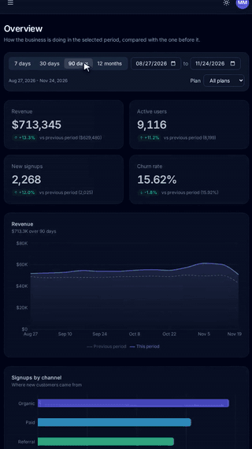

# Pulse

A SaaS analytics dashboard. Pick a date range and the KPIs, charts and tables all update. Search, sort and page through 248 customers. Every view lives in the URL, so it can be shared.

**Live demo:** https://malakmo7amed309.github.io/pulse/



## Features

- Sidebar layout with a mobile drawer, light and dark mode (follows the system, saved in the browser)
- Date range filter (presets or custom dates) and plan filter. KPIs compare with the previous period
- Charts react to the filters: revenue trend, signups by channel, revenue by plan. Data is grouped by day, week or month depending on the range
- Customers table with search, plan and status filters, sortable columns, pagination
- Loading skeletons, empty states and error states with retry. Settings has a slider for response delay and a switch that makes the API fail, so you can see each state
- Filters and table state are kept in the URL (`range`, `from`, `to`, `plan`, `q`, `sort`, `dir`, `page`)

## Tech and structure

React 19, TypeScript (strict), Tailwind CSS 4, Recharts, React Router (HashRouter, because GitHub Pages has no server routing), Vite.

```
src/
  types.ts          shared types
  data/             seeded mock data and a fake async API
  lib/              pure functions: dates, formatting, analytics
  hooks/            useAsync (race-safe), useFilters, useCustomerQuery
  context/          theme and demo settings
  components/       ui, layout, charts
  pages/            Overview, Revenue, Customers, Settings
```

Design choices worth explaining:

- **Fake API with latency**: pages fetch through `useAsync`, so loading and error states are real code paths. `useAsync` ignores out-of-date responses when filters change quickly.
- **URL as state**: filters are read from and written to the query string, so reload and share links work.
- **Pure analytics functions**: `lib/analytics.ts` has no React in it, which keeps the numbers easy to reason about.
- **Seeded data**: the same numbers on every load, so the demo is predictable.

## Run it

```
npm install
npm run dev
npm run build   # type-checks, then builds to docs/
```
